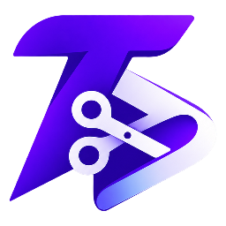

# TeraClip Studio

**A local-first AI clipping studio.** Paste a stream, VOD or highlight link — or record a live channel straight to disk — and get 1–10 ready-to-post vertical clips with word-perfect animated captions, hook cards, smart face reframing and platform-ready posting kits.

No login. No database. No cloud dashboard. Every project, clip, campaign and counter lives in this folder.

<p align="center">
  
</p>

---

## Why it feels different

- **Runs on this laptop.** The UI, the recorder, transcription, face tracking and rendering are all local.
- **AI is a scalpel, not a dependency.** Whisper.cpp transcribes locally. Audio energy, chat rate and captions score moments locally. Gemini is optional and used only for editorial judgement.
- **Free to keep running.** No credits, no subscriptions, no API key required for the core pipeline.
- **Real clips, not previews.** MP4 exports with burned-in word-timed captions, hook overlays, smart crops and optional watermark.
- **Clean live capture.** A native stream copy — no screen recording, no dropped frames, no browser tab that has to stay open.

## What it does

| Area | What you get |
| --- | --- |
| **Sources** | YouTube, Twitch, Kick, Rumble, X and TikTok links, plus direct MP4/MOV/MKV/WebM uploads |
| **Moment finding** | Local transcript analysis, audio-energy peaks, optional Gemini editorial pass, chat-heat boost from live recordings |
| **Captions** | Word-level timing, six looks: Tera Box (default), Hormozi, Purple Pop, One Word, Neon, Clean — plus a 60–160% size slider per project and per clip. Editable subtitle rows rewrite and re-time the burn-in on save |
| **Hooks** | Top-centre hook card rendered as a transparent PNG; white, ink or purple cards, or no hook |
| **Reframing** | YuNet face tracking with smooth alpha-beta crops. **Auto (default)** notices whether a clip is one full-frame camera or a small cam overlaid on a moving game, then picks smart face crop or the game + cam stacked layout. Smart, game + cam, centre and blurred backgrounds can also be forced |
| **Live** | 6-second MPEG-TS segments, auto-reconnect, live stream thumbnail, Twitch/Kick chat capture, heat timeline, one-click creator radar |
| **Campaigns** | Brand briefs, required tags/mentions, submission tracking, payout estimates — all local |
| **Library** | Per-clip downloads, posters, captions, posting kits, star favourites, multi-select delete, download all and ZIP export |
| **Persistence** | JSON index in `data/`, lifetime counters that survive restarts and project deletion |

## Requirements

- **Node.js 20+** (Windows, macOS or Linux).
- **Windows 10/11 64-bit** for the one-click whisper.cpp download. On macOS/Linux, install whisper.cpp yourself and set `WHISPER_PATH`.
- **~8 GB RAM** is enough with the default `base.en` model. An 8-core CPU helps; CUDA is optional.
- **~10 GB free disk** for tools, models, sources and clips. Long streams need more.
- Internet for the first tool download and for importing online sources.
- No Python, no Docker, no database server, no account.

## Quick start

```powershell
# 1. Install dependencies (ffmpeg and ffprobe come bundled here)
npm install

# 2. Optional cloud editorial pass
Copy-Item .env.example .env.local
#    then put your free Gemini key in GEMINI_API

# 3. Download yt-dlp, whisper.cpp, the speech model, face tracker and fonts
npm run setup

# 4. Start the dev app
npm run dev
```

Open the URL Vite prints — normally **http://localhost:5173**. If `localhost` does not resolve on your machine, use the printed address exactly; Vite is started on `localhost`, while the API listens on `127.0.0.1:8484`.

For production:

```powershell
npm run build
npm start
```

Open **http://127.0.0.1:8484**. `npm start` serves the built UI and the API from one process, so closing the terminal stops both.

### If you skip `npm run setup`

The app still starts. Open **Settings → System health → Repair toolkit**, which runs the same downloads from inside the UI. Builds are slow the first time because the model and tools are large.

## How a clip is made

1. **Read the source.** yt-dlp resolves the link; ffprobe reads duration, dimensions and frame rate. Uploads are copied into `data/uploads/`.
2. **Hear the words.** Audio is decoded to mono 16 kHz WAV and transcribed by whisper.cpp with word timestamps. Long sources are split into safe chunks.
3. **Find the story.** Audio energy, transcript structure, laughter/applause cues and (for live) chat heat create candidates. Gemini, if enabled, makes the final editorial choice from a small candidate pool. Nothing is sent to Gemini except short transcript excerpts and metadata.
4. **Plan the clip.** The strongest moments are cut to your duration window, scored, titled, hooked and given hashtags.
5. **Reframe.** YuNet finds faces; a smoothed alpha-beta tracker keeps the speaker in frame. Falls back to centre or blurred background when no face is stable.
6. **Render.** ffmpeg burns in the caption cards (at your chosen size), hook PNG, optional watermark and, only if **Clean up the audio** is on, a gentle loudness match. When **Render speed** is `auto`, it probes Intel Quick Sync, NVIDIA NVENC and AMD AMF once and uses whichever hardware H.264 encoder actually works; any failure silently falls back to `libx264`.
7. **Keep it.** Everything is written under `data/projects/<id>/`, indexed in `data/index.json`, and served to the UI via `/media/`.

### Story check (does the clip make sense on its own?)

A clip that starts mid-thought is unusable, however strong the moment was. Before a range is scored, the analyser runs the same checklist a human editor would:

1. **Who or what?** The opening line must name the person, item, game, price or situation. A range that opens on "it", "that", "this", "he" or on a bare answer like "$440" is widened backwards until the line it depends on is inside the clip (up to four sentences / 4.5 s away, within the duration cap).
2. **What is the question?** A question, bet, problem or claim has to be set up inside the range.
3. **Is it answered?** If the clip raises a question, the answer must also be inside the range. A clip that stops on a question is rejected.
4. **Does it end cleanly?** The last line has to finish a sentence, and any question the clip raises has to be answered before it stops. A range that ends on "and", "because", "the", "could" or "have" pulls in the next line; a range that ends on (or just before) the answer to its own question runs on to that answer.
5. **Does anything depend on a missing line?** If a line only works with something said outside the clip, the range is rejected.

Every candidate is scored on `setup`, `resolution` and `ending`; clips that fail are used only to fill a shortfall, never to pad the library. The verdict is written to the clip's **why this clip** line, and the same checklist is sent to Gemini, which is told to reject any id that fails it. Titles and hooks are built from complete spoken lines only — a hard-truncated fragment like "going for flight box to be down on the" is never used as a title.

Live auto-clips wait for a 24 s tail to be recorded instead of clipping the instant chat reacts, so the answer lands inside the window. A chat surge alone never arms auto-clip: it must coincide with a real audio beat inside the window, so raids, donations and late reactions do not become projects. To inspect a stored project without re-rendering, run `npx tsx scripts/probe-story.ts <projectId>`: it replays the saved transcript through the local analyser and prints what a cold viewer sees at the start and end of each pick.

### Auto framing (smart noticing)

The default **Auto** mode samples a clip before rendering and notices its layout before choosing a crop:

- **One full-frame camera** (IRL, just chatting, a webcam filling the stream) is tracked like **Smart**. The face stays centred in the vertical frame. Nothing is stacked, so the same facecam cannot appear twice.
- **A corner facecam over gameplay** becomes **Cam + game**: a tracked crop of the webcam fills the top 36% and the *whole* 16:9 game frame is fitted into the bottom 64% over a blurred copy of itself, so the HUD and edge action stay visible. Dark or slow games still count — the signal is a small face in the corner of a landscape source, not motion alone.

Text stays inside the platform safe area: the hook sits in the top reserve, and burned captions for this layout are raised clear of the bottom UI zone. If no stable face is found, the clip keeps the centre of the frame. Each clip stores what was noticed (`single cam` or `cam + game`), so an edit re-render reuses the same layout instead of guessing again. Projects rendered before Auto existed can be fixed in one click with **Re-notice framing** on the project page: it switches every finished clip to Auto, re-renders them one by one, and logs the result. Live auto-clips use Auto automatically, whatever the old gameplay-only default was; pick **Centre** or **Blur fill** in Settings to override it. Existing v1 settings are migrated once, and the decision is written to the project log for each clip.

### Caption size

Every caption look has a **Caption size** slider from **60% to 160%** (100% is the preset default). It appears in three places:

- **Settings → Default look** sets the default for new projects.
- **New clips → Step 02** sets it for that project before clipping starts.
- **Project → clip editor → Caption look** sets it for one clip and marks the clip for re-render on save.

The scale is applied to the ASS `Fontsize` value, so it is burned into the MP4 — not a CSS-only preview trick.

### Render speed

Rendering is the heaviest local step: ffmpeg decodes, crops, scales, burns captions and re-encodes every frame. TeraClip already renders one clip at a time and reuses face tracking on edit re-renders. On this laptop (4 cores / 8 threads), a short hardware test showed:

- `h264_qsv` (Intel Quick Sync): 5.58 s for a 10 s 1080×1920 captioned clip.
- `libx264`: 9.77 s for the same clip — about 43% slower.

Set **Settings → Render speed** to `cpu` if a hardware encoder produces driver glitches. Whisper threads default to `0` (auto: logical cores, capped at 8); on the same 744 s source, 8 threads took 195.9 s versus 249.1 s on 4 threads.

### Audio cleanup

**Clean up the audio** is **off by default**. Stream audio is normally already compressed and EQ'd by OBS, so a second compressor made the voice sound flat and "not like the streamer".

When enabled, the chain is deliberately minimal:

1. A 35 Hz highpass removes sub-bass rumble only.
2. A **two-pass linear** `loudnorm` measures the clip first, then applies one constant gain to hit **-14 LUFS / -1.5 dBTP / LRA 11**.

There is no compressor, makeup gain or EQ colouring. On a 28.9 s test clip the source measured `-27.1 LUFS / LRA 11.0`; the render measured `-13.7 LUFS / LRA 10.2 / TP -1.5`, so the dynamics survived and the target was met. Single-pass loudnorm undershot on short quiet clips, which is why the extra measurement pass exists.

## The Gemini leash

Gemini is **optional**. Without a key, the app uses local scoring only. With a key:

- Only `gemini-2.5-flash` (or the model you set) is called, and only for moment selection/hook judgement.
- Prompts are cached on disk under `data/cache/gemini/`, so re-planning a project does not spend another call.
- A hard daily ceiling applies. Default is **40 calls/day**; set `GEMINI_DAILY_LIMIT` in `.env.local`, and lower it further in Settings.
- **Set the daily limit to `0` to disable cloud calls entirely.**
- Failures fall back to the local analyser, so a dead key never blocks a project.

## Live recording, chat lag and the creator radar

### Clean capture

The recorder pulls the stream URL directly with ffmpeg `-c copy`, cutting 6-second MPEG-TS segments into `data/live/<session>/segments/`. There is no screen capture and no re-encode. If the connection drops, the supervisor reconnects and continues segment numbering. Closing the tab does **not** stop recording.

Chat capture is connected for **Twitch** and **Kick**. Other platforms still record audio and video, but their chat heat is not available.

### Live storage

A 1080p stream copy costs roughly **3 GB per hour** (measured: 41.6 MB in 49 s ≈ 0.85 MB/s); 720p roughly halves that. TeraClip avoids holding multiple copies of the same stream:

- On stop, the TS segments are remuxed into one `recording.mp4`, then the segments and `concat.txt` are deleted. If the remux fails, the segments are kept so the recording can still be recovered.
- When a clip project adopts a live recording, it stages a **hard link**, not a copy, so no second full-size file is written. The session link is deleted unless **Settings → Live recorder → Keep the raw live recording** is on.
- Auto-clip staging files are removed as soon as the project has adopted the moment.
- Active sessions show **On disk** and a projected **Write rate** so the cost is visible while recording.

For long streams, turn on **Moment buffer only** (requires auto-clip). It keeps a rolling window of `lookback + 180 s` — about 5 minutes by default — and deletes older segments once they have been scored and are behind the current moment. Chat heat and detected moments are rebased to the retained recording at stop. You cannot re-cut the whole stream afterwards; the auto-clipped projects are the output. With the default 90 s lookback the buffer is around 250 MB at 1080p instead of 3 GB per hour.

### Chat lag correction

Chat is usually late: stream delay, chat delay and human reaction time stack up, often by 10–20 seconds. TeraClip treats a chat surge as a *pointer backwards*, not as the event itself:

- On a chat surge it rewinds by **Chat reaction lag** (default **14 s**, range 0–45).
- It then searches ±8 s around that anchor for the strongest audio beat and snaps to it.
- Auto-clip ends roughly 18 s after the anchor so the reaction is included, constrained by the lookback window.
- Configure both in **Settings → Live recorder**.

### Creator radar

The Live page ships with a pre-seeded watchlist of 24 popular Twitch, Kick and YouTube creators. It checks who is live without any API key:

- Twitch via the public GraphQL endpoint.
- Kick via its public channel API.
- YouTube via the channel's `/live` page.

Status is cached for 45 seconds, the UI polls every minute, and live creators are sorted first. Click **Record & clip** on a live card to start a clean recording with auto-clip armed. Offline creators can be removed with the trash button; the roster is stored in `data/index.json`, so removals stick across restarts. Add your own handle or channel URL with the form in the panel. Auto-clip is local and does not call Gemini.

## Campaigns — what they are and why use them

A **campaign** is a local folder for one brand, client or clipping challenge. It keeps the brief and the results together.

A campaign stores:

- name, brand, main platform and status (active / paused / ended);
- payout per 1,000 views (optional);
- rules: min/max clip length, aspect ratio, required hashtags, required mentions, CTA and free-form notes;
- every submission made from your clips: platform, URL, views, earnings and status.

**Why create one?**

1. **Rules stay attached.** When you attach a project to a campaign, the posting kit can include the required tags and mentions. You are less likely to post a 61-second clip into a 60-second challenge.
2. **Everything is grouped.** Filter submissions by brand, see which clips were posted where, and keep client work out of your personal library view.
3. **Payout estimates.** Enter views and the campaign's payout rate; TeraClip calculates an estimate locally. No spreadsheet.
4. **A paper trail.** Submitted URLs, dates and earnings survive restarts, so you know what was paid and what is still pending.

Campaigns are **optional bookkeeping**. They do not log into platforms, apply to any brand programme or post anything automatically. If you only clip for yourself, skip them. If you clip for a sponsor or a clipping programme, create one campaign per brief and add submissions as you post.

Typical flow: **Campaigns → New campaign → fill the brief** → **New clips → choose campaign** → render → **Library → copy posting kit** → post → **Campaigns → Add submission** with the live URL and views.

## Where everything lives

| Path | Contents |
| --- | --- |
| `data/index.json` | Settings, project summaries, campaigns, submissions, live sessions, Gemini usage, creator radar and lifetime counters |
| `data/projects/<id>/project.json` | Full project, clip records, caption/hook metadata and logs |
| `data/projects/<id>/transcript.json` | Word-level transcript used for captions |
| `data/projects/<id>/clips/` | Rendered MP4s, posters, ASS/SRT captions and hook PNGs |
| `data/uploads/` | Imported source files and live auto-clip sources (transient; moved into the project) |
| `data/live/<id>/segments/` | 6-second MPEG-TS segments (deleted after the recording is finalised) |
| `data/cache/gemini/` | On-disk Gemini response cache |
| `data/logs/` | Server logs |
| `tools/` | yt-dlp, whisper.cpp, speech models, YuNet and caption fonts |

**Backup:** stop the app, then copy the whole `data/` folder. Copy `tools/` too if you want to avoid re-downloading binaries. Restoring is just putting the folders back.

**Reset:** stop the app and delete `data/`. This removes the library, campaigns, recordings and settings. Deleting only `data/index.json` loses the index but can leave orphaned project folders; prefer clearing the whole folder.

The Dashboard's **Saved on this laptop** shelf reads lifetime counters from `data/index.json`:

- projects created;
- clips planned;
- renders completed;
- seconds rendered;
- live seconds captured.

They are incremented as work happens and are **not** decremented when a project or clip is deleted. If the ledger is introduced after projects already exist, it is backfilled once from what is on disk.

## Scripts

| Command | What it does |
| --- | --- |
| `npm run dev` | API on `127.0.0.1:8484` + Vite on `localhost:5173` |
| `npm run build` | Build the UI into `web/dist` |
| `npm start` | Serve the built UI + API from `127.0.0.1:8484` |
| `npm run typecheck` | TypeScript check for server, shared code and UI |
| `npm run setup` | Download missing local tools and models |
| `npm run setup -- --force` | Re-download tools even if files exist |
| `npm run setup:force` | Same as above |

Brand icons can be regenerated from `assets/logo+favicon/teraclip.png` with `npx tsx scripts/build-brand.ts`.

## Project layout

```text
server/                 Fastify API, pipeline, live recorder, storage
  services/             analyse, transcribe, captions, hook, reframe, render, live, creators
  lib/                  JSON store, logger, process helpers, event bus
shared/                 Types, presets, platform data, creator seeds
web/                    React 19 + Vite + Tailwind v4 UI
  pages/                Dashboard, New clips, Project, Library, Live, Campaigns, Settings
  components/           UI primitives, media cards, creator radar
  styles/               Design tokens and page styles
scripts/                Setup and probe utilities
assets/                 Original logo and caption references
data/                   Your local library (created at runtime)
tools/                  Downloaded binaries and models (created at runtime)
```

## Troubleshooting

| Problem | Fix |
| --- | --- |
| **`localhost:5173` refuses to connect** | Use the exact URL Vite printed. The API is on `127.0.0.1:8484`; Vite may bind IPv6 `localhost` only. |
| **Production page says the UI has not been built** | Run `npm run build` before `npm start`. |
| **Port 8484 is busy** | Stop the other TeraClip process, or set `PORT=8485` in `.env.local` for production. In dev, also update the proxy target in `vite.config.ts`. |
| **Missing ffmpeg / yt-dlp / whisper / face tracker** | Settings → System health → Repair toolkit, or `npm run setup -- --force`. |
| **yt-dlp says 403, login required, or the video is age-gated** | Settings → Cookies. Pick a browser or a Netscape-format `cookies.txt`, then retry. |
| **Whisper is slow on an 8 GB laptop** | Keep `base.en`; try `tiny.en` in Settings; leave `ASR_THREADS=0` (auto) or set it to your logical core count; close heavy apps. First run also downloads the model. |
| **Rendering is slow or a hardware encoder glitches** | Settings → Render speed. `auto` uses Quick Sync / NVENC / AMF when the driver accepts it; switch to `cpu` for a predictable `libx264` encode. |
| **Live recorder starts then reconnects repeatedly** | The channel may be private, region-locked or using a URL yt-dlp cannot keep alive. Try cookies, lower capture quality, and check the session log. |
| **No chat heat on a live recording** | Chat capture is Twitch/Kick only. YouTube and other live sources record audio/video without chat. |
| **A project is stuck in “rendering”** | Restart the server; interrupted projects are recovered. Settings → Housekeeping also clears temp/partial files. |
| **Clips are too long / too short** | Change the duration window in Settings or per project. Campaign rules can also cap duration. |
| **I want a clean slate** | Stop the app and delete `data/`. Back up first. |

## GTA 6 and game-launch streams

Yes — the same idea and format apply directly. A GTA 6 live stream is just another live source, and a GTA 6 VOD is just another import.

- The **creator radar** already includes streamers who are likely to stream GTA 6. Click a live card to record with auto-clip armed.
- **Chat will explode** at mission reveals, fails, police chases and story beats. The chat-lag rewind is exactly what keeps those clips anchored to the real moment instead of the delayed reaction.
- **Recommended starting point:** 9:16, smart reframe, Tera Box captions at 100–115%, 18–45 s clips, chat lag 12–18 s, auto-clip threshold around 65–70.
- For story-heavy streams, use **Campaigns** to keep sponsored briefs and posting rules separate, and check Rockstar/Take-Two's content policy plus each platform's rules before posting or monetising story spoilers.
- If the stream is uploaded as a VOD later, use **New clips** and the same pipeline; no live capture needed.

## Credits

Built with Fastify, React, Vite, Tailwind CSS, ffmpeg, yt-dlp, whisper.cpp, OpenCV Zoo's YuNet, `@napi-rs/canvas`, Lucide icons and the Poppins/Anton/Bebas Neue fonts (SIL Open Font License). Third-party tools keep their own licences.

TeraClip Studio is a local, private project — keep `data/` and `.env.local` out of version control.
